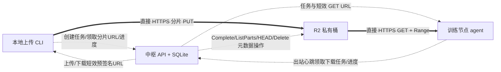

# Cloudflare R2 / Workers 文件备用通道评估

核查时间：2026-10-16。范围：公开官方文档与当前仓库源码，只读核查；未创建 Cloudflare 账户、订阅、桶或 Worker，未读取凭据，未上传文件。`developers.cloudflare.com` 在本环境返回 HTTP 403；通过正常代理读取 Cloudflare 自己公开的 [cloudflare-docs](https://github.com/cloudflare/cloudflare-docs) 文档源码。固定快照：`f775315898df547b0dd049879f084523df136a33`。以下“官方确认”指该官方文档快照，服务端行为未实测。

**优先结论**

1. R2 的 S3 预签名上传和下载可以满足“本地 → 临时对象存储 → 训练节点，中枢只传任务/URL/进度”，技术接口比当前未核实无头下载接口的 storage.to 更完整。R2 可直接返回真正的文件 GET URL，支持 Range；不需要经过下载网页，也不需要部署 Worker。
2. Workers + WebDAV 可以作为应用层接口，但 Worker 本身不提供 10GB 持久文件空间；仍须 R2 或其他后端。免费账户单次请求体上限 100MB，普通 WebDAV 客户端的一个 10GB PUT 会被拒绝。HTTP chunked 编码不会把一个请求变成多个独立分片请求。若要 WebDAV，必须确认客户端与服务端拥有相同的分片协议，并把分片落在 R2；普通 WebDAV 并不自动保证断点续传。
3. 推荐 R2 私有桶 + 预签名分片上传，Worker 仅作为可选签名/调度服务。免费额度是 Standard 的 **10 GB-month/月**，加 100 万 Class A、1000 万 Class B 请求；R2 出口免费。它要求 Cloudflare 账户及 R2 订阅 checkout，不是匿名服务，也不是“到 10GB 自动拒绝”的免费硬限额。具体支付方式是否要求信用卡，本次未进入 checkout 验证。
4. 可以在 P2P 连接失败时选择 R2，但不能把所有 SSH 错误都作为回退依据。主机密钥不符、节点吊销、身份认证失败、目的路径权限错误必须原样失败。尤其当前创建传输会先经中枢 FRP/SSH 授权；该步骤失败时还没有可用上传任务，需要把对象传输任务从 SSH 授权准备中独立出来，不能只在 CLI 最外层 `except` 填一个 HTTP 上传。

**已由官方文档确认的能力和限制**

| 项目 | 官方内容 | 对本项目的意义 |
| --- | --- | --- |
| R2 免费额度 | Standard 10 GB-month/月；Class A 100 万/月、Class B 1000 万/月；出口免费 | 低频 10GB 临时周转有机会保持免费；必须计算所有已完成对象与未完成分片，设置项目容量预留和清理 |
| 存储计费口径 | 每日峰值容量，在 30 天周期求平均；Standard 超额 $0.015/GB-month；计费单位向上取整 | `10 GiB` 约 10.74GB，不能当作免费 10GB；旧文件、新文件、未完成分片重叠可能超额 |
| R2 启用 | “You need a Cloudflare account with an R2 subscription.”；需完成 checkout | 应用客户无需自建桶，但运营方必须先配置 R2 计费账户；无需因为使用 R2 就购买 Workers Paid |
| 预签名 URL | GET/PUT/HEAD/DELETE；有效期 1 秒至 7 天；在服务器本地签名，不必请求 R2 | 中枢分发短效 URL，用户/节点不持有 R2 长期密钥；真正无头 GET/PUT |
| URL 域名 | 预签名仅用于 `<ACCOUNT_ID>.r2.cloudflarestorage.com` S3 API 域名，不能直接换自定义域名 | 不要把已签 URL 换为 WebDAV 域名或 CDN 域名；签名 URL 查询串不得写日志 |
| 单个上传/对象 | 文档名义上限单次 5GiB、分片对象 5TiB，limits 页脚注给出略低实际界限；最多 10000 分片 | 10GB 文件必须分片；建议 16–32MiB 等长分片、最后一片可小些，远离大请求上限 |
| 分片 | 每片至少 5MiB（最后一片除外）；除最后一片外等长；create/upload/listParts/complete/abort 已支持 | 可按 `upload_id + part_number + ETag` 实现进程重启恢复；支持不等于 CLI 自动拥有持久化恢复 |
| 同一分片重写 | 重写同一 part number 会替换之前部分；若新写失败，旧分片也会丢失 | 丢响应/重启先 ListParts 对账；不要无条件重复覆盖已确认分片 |
| 下载续传 | GetObject 支持 `Range`、`If-Match`；Worker binding 也支持 ranged reads，但不支持 `If-Range` 条件 | 使用不可变对象 key、ETag、`Range + If-Match`；只有 206 且 Content-Range 正确才追加本地文件；200 必须重开，412 失败重确认 |
| URL/对象期限 | URL 到期与对象删除是不同机制；未完成 multipart 默认 7 天自动 abort；对象生命周期删除通常在到期值之后 24h 内 | 下载完成后立即显式删除，生命周期作为兜底；不能靠 URL 到期回收容量，也不能假设生命周期瞬时清理 |
| Workers 免费 | 10 万请求/天（UTC 午夜重置）、10ms CPU/请求、128MB/isolate、每次 50 个外部子请求 | 只做签名元数据相对合适；CPU 不是网络等待时间，流式传输不能全文件缓存在内存 |
| Workers HTTP | Free/Pro 账户请求体 100MB；Business 200MB；响应体无强制大小上限；HTTP 连接存续时没有固定墙钟时长上限 | 不能声称“Worker 10ms 只能传 10ms”，也不能声称单个 10GB PUT 能通过；流式下载可以更大，但仍可能断线 |
| Workers 存活 | 客户端断连后任务可取消，waitUntil 最多延长 30 秒；运行时更新旧进程有至多 20 分钟排空期，也可能更早中断 | 一次长连接不是可靠任务队列；必须依赖持久任务/分片/重试，不得把后台传完整文件寄托于 waitUntil |
| Workers 连接 | 每 invocation 最多 6 条处于“等待响应头”阶段的外连；收到头后不再计入该限制 | 控制并发，不能简单写成整个生命周期只能 6 个流 |
| 公共 r2.dev | 测试用途，按可变速率限制且带宽可能节流 | 用私有 S3 预签名 API；不依赖公共测试 URL 做生产备用传输 |

来源和摘录：

- [R2 pricing](https://developers.cloudflare.com/r2/pricing/)；[固定源码](https://github.com/cloudflare/cloudflare-docs/blob/f775315898df547b0dd049879f084523df136a33/src/content/docs/r2/pricing.mdx#L48)：`10 GB-month / month`，`1 million requests / month`，`10 million requests / month`；`averaging the peak storage per day`。含 DeleteObject/AbortMultipartUpload 免费及 R2 S3/Workers API 出口免费说明。
- [R2 get started](https://developers.cloudflare.com/r2/get-started/)；[固定源码](https://github.com/cloudflare/cloudflare-docs/blob/f775315898df547b0dd049879f084523df136a33/src/content/docs/r2/get-started/index.mdx#L16)：`Complete the checkout flow to add an R2 subscription to your account.`
- [R2 presigned URLs](https://developers.cloudflare.com/r2/api/s3/presigned-urls/)；[固定源码](https://github.com/cloudflare/cloudflare-docs/blob/f775315898df547b0dd049879f084523df136a33/src/content/docs/r2/api/s3/presigned-urls.mdx#L11)：`granting temporary access to objects without exposing your API credentials`，`Timeout from 1 second to 7 days`。文档给出了直接 `curl` GET/PUT 的示例。该页的“POST multipart form uploads 不支持”是浏览器表单接口，不能误读成 S3 multipart 不支持。
- [Upload objects](https://developers.cloudflare.com/r2/objects/upload-objects/)；[固定源码](https://github.com/cloudflare/cloudflare-docs/blob/f775315898df547b0dd049879f084523df136a33/src/content/docs/r2/objects/upload-objects.mdx#L830)：分片大小/等长、恢复、ETag 语义。multipart 最终 ETag 不是全文件 MD5，不能作为全文件 MD5 比较。
- [S3 compatibility](https://developers.cloudflare.com/r2/api/s3/api/)；[固定源码](https://github.com/cloudflare/cloudflare-docs/blob/f775315898df547b0dd049879f084523df136a33/src/content/docs/r2/api/s3/api.mdx#L129)：GetObject Range/If-Match，multipart API，重写分片的特殊失败行为。
- [Object lifecycles](https://developers.cloudflare.com/r2/buckets/object-lifecycles/)；[固定源码](https://github.com/cloudflare/cloudflare-docs/blob/f775315898df547b0dd049879f084523df136a33/src/content/docs/r2/buckets/object-lifecycles.mdx#L17)：`Objects will typically be removed ... within 24 hours`，`expire multipart uploads seven days after initiation`。
- [R2 limits](https://developers.cloudflare.com/r2/platform/limits/)；[固定源码](https://github.com/cloudflare/cloudflare-docs/blob/f775315898df547b0dd049879f084523df136a33/src/content/docs/r2/platform/limits.mdx#L11)：对象/请求上限，r2.dev 的生产限制。
- [Workers limits](https://developers.cloudflare.com/workers/platform/limits/)；[固定源码](https://github.com/cloudflare/cloudflare-docs/blob/f775315898df547b0dd049879f084523df136a33/src/content/docs/workers/platform/limits.mdx#L20)：免费请求、CPU、内存、请求体、墙钟时间与更新排空限制。
- [Workers pricing](https://developers.cloudflare.com/workers/platform/pricing/)；[固定源码](https://github.com/cloudflare/cloudflare-docs/blob/f775315898df547b0dd049879f084523df136a33/src/content/docs/workers/platform/pricing.mdx#L16)：Workers Paid 起价 $5/月；不应为简单 R2 直传默认增加这一项。

**完整数据和控制路径**

这里两个大文件数据阶段不经过中枢，训练节点只要能出站 HTTPS，无需成功打洞。先落 R2 再下载比直连多一次存储周转和两段时长，不能保证比成功的 P2P 更快；它解决 NAT/UDP 不可达时的可用性。端点可达性、训练机出口限制、跨境速度仍要现场小文件验证。

**本项目最小适配方案（建议，未实现）**

首先保持现有 XTCP 通道，新增显式 `transport=auto|p2p|r2`。`auto` 仅在管理员启用 R2、客户端选择允许备用、P2P 失败类型适合回退时自动切换。可以用连接预算决定何时切换，但首次连接/稳定后的实测再确定默认时间，不应只把现有 180 秒改短而破坏 NAT 成功率。

对外任务接口复用 `/api/transfers` 的认证、SQLite 记录和进度框架，最少新增：

| 接口/函数 | 输入与输出 | 约束 |
| --- | --- | --- |
| `POST /api/transfers` | node_id、manifest、destination、transport、idempotency_key → task_id、task_token、transport_plan | R2 任务不依赖注入临时 SSH key；容量预留一次，重复调用复用任务 |
| `POST /api/transfers/{id}/objects` | 文件相对路径/size/mtime → opaque object_id、upload_id、part_size | R2 key 由服务端生成，使用 job/object UUID，不拿用户路径当对象权限范围 |
| `POST .../objects/{object}/parts` | 最多一个小批次的 part numbers → URL、expires_at、required_headers | 按需签名 5–15 分钟，仅对本任务未完成部分；不一次预签全文件所有片 |
| `GET .../objects/{object}/parts` | → 服务端 ListParts 与当前状态 | 进程恢复时对账，不能只信客户端 sidecar |
| `POST .../objects/{object}/complete` | parts/ETags → object_etag、size、download_ready | 核实对象大小/分片集；幂等处理响应丢失，不重复创建对象 |
| 节点心跳/任务领取 | node_id + 节点凭据 → 下载 job、lease、受限目的路径、GET URL | 只给绑定节点；后台执行，不阻塞心跳；租约可续，避免重启重复下载 |
| `POST .../download-url` | node-specific task token → refreshed GET URL/etag | URL 到期后重新签发，重新核验节点未吊销、任务未过期 |
| 现有 `.../progress` | transport、phase、upload_bytes、download_bytes、attempt、reason、state_version | 上行与下行分别计数，避免 10GB 对象显示成 20GB“已完成”；防迟到状态回退 |
| `POST .../cancel` + 清理器 | → cancelled/cleanup_pending | AbortMultipartUpload/DeleteObject，失败持久重试；不得靠生命周期立即腾空 |

后端适配器只需 `create_upload / presign_parts / list_parts / complete_upload / presign_download / head / abort / delete`，不做复杂通用存储框架。中枢可复用 HTTP 客户端及经过维护的 SigV4 签名实现，或将这一层放在小型 Worker 绑定 R2；二选一，避免同时引入两套基础设施。不要自行实现密码学算法。若采用 SDK，按需加载，先测实际安装体积与常驻 RSS，不让全部节点安装 boto3/Node/Wrangler。

建议状态为 `queued → connecting_p2p → uploading_object → ready_to_download → downloading → completed`，另有 `retry_wait / paused / failed / cancelled / expired`；保留 `transport` 与 `failure_stage/reason`。不必把所有这些都塞进原有 `status` 枚举，可保持任务顶层粗状态并扩展 `phase`；但现有 progress 的 status/phase 验证、SQL 单调状态约束、UI、FRP 凭据授权必须一起检查。`progress_stale` 仍表示观测失联，不直接等同文件失败。

**恢复、资源占用和失败边界**

- 上传 sidecar 原子保存 `task/object/upload_id/part_size/已确认 parts/源文件 size+mtime`；权限 0600；不保存永久存储密钥，URL 无须持久化。恢复先检查源文件是否变化，再 ListParts 对账，只补缺片。进程中断可暂停保留分片至任务 TTL；明确取消才 abort。URL 过期可重签对应分片；403 需要区分签名到期、权限吊销、签名错误，不能无限刷新掩盖拒绝访问。
- 429/网络超时/部分 5xx 有限退避并加抖动；尊重 Retry-After；同一片同一时刻一个请求。建议初始 2 路并发、16–32MiB 分片，读取流用 1MiB 级 buffer，避免每条并发把全片留内存。中枢只拿元数据，无法被 10GB 文件撑满内存。
- 下载写 `target.part`，sidecar 绑定 immutable key+ETag+预期长度。重启以磁盘实际长度发送 Range + If-Match；验证 206/Content-Range/ETag，完成后核对长度并原子 rename。200 不可追加；412 必须停止核实对象；404 区分尚未完成和已到期。可选完整性摘要在正常读写路径计算一遍，避免反复扫描全部数据；multipart ETag 不等于全文件摘要。
- 对象到期/节点长期离线时返回明确 expired，不报告 completed。下载端确认落盘后才删除；Delete 失败保留 cleanup_pending，由巡检器重试，并记录 reserved_bytes 与实际占用，先成功释放再接新大文件。生命周期通常最多 24h 清理滞后，不能单独保障瞬时 10GB。
- 普通 heartbeat 的任务领取和独立后台下载 worker 能让 NAT 故障节点通过 HTTPS 收到任务；复用当前 AgentUpdater 的后台模式，但下载应有独立资源上限，不与更新线程互相占用。执行完成状态持久化，避免中枢重启导致重复下载或覆盖文件。
- 两端路径检查复用 SFTP 上传已有的目录/覆盖保护语义；限制到许可目的目录，不把领取任务变成任意 URL/任意路径写入工具。用户指定 overwrite 才覆盖，不接受逃出目录的 `..`/绝对 manifest 路径。
- 永久 R2 凭据只留中枢受限配置或 Worker secret；client/node 只拿任务 token 与短效 URL。日志不记录 URL 查询串；桶保持私有。任务容量预留不是云平台费用硬上限；还需限制任务数量、签名的对象/分片/有效期，并验证实际 Content-Length。

回退分类：

| 失败 | 是否可自动切换 R2 | 理由 |
| --- | --- | --- |
| UDP/NAT 打洞预算耗尽，节点心跳仍有效 | 是，管理员启用、该任务允许时 | 传输通道不可达，节点身份仍可信 |
| QUIC/KCP 会话无法建立、连接超时/重置 | 是，按失败阶段和有界重试 | 记录原始通道失败，与吞吐不足分开 |
| 已达 SSH 但网络断开 | 可在明确失败、保留目的文件保护后转 R2 | 已传字节与备用新传输分开；不能同时写同一目标文件 |
| SSH 主机密钥不符/认证失败/节点被撤销 | 否 | 不能换通道绕开身份/访问控制失败；需先解决授权 |
| 目标磁盘满/权限拒绝/目标已存在且未允许覆盖 | 否 | 换通道不能解决目的端写入条件 |
| frpc 校验失败/配置错误/可执行文件不兼容 | 默认否 | 应报告安装/配置错误；并非 NAT 失败，管理员仍可显式另建 r2 任务 |

**预计涉及文件**

- `app/app.py`：当前 `create_transfer`（本次读取约 374 行）强制 SSH 授权；加任务类型/分片元数据接口与节点领取，验证进度扩展；`progress` 约 431 行。
- `app/static/transfer.py`：`connect_direct`（约 260 行）区分身份错误和超时；`main`（约 413 行）当前只接受 P2P，新增策略选择与可恢复分片客户端；`upload` 目标保护语义复用。
- `app/static/node.py`：现有心跳约 79 行、主监督循环约 900 行；增加有界下载后台 worker，主线程只领任务/报告状态，不同步下载。
- 一个小型 `app/object_store.py`：R2 适配器；配置校验在启用功能时运行，默认禁用、缺配置不能悄悄走中枢文件转发。
- `app/static/index.html`：显示 P2P/R2 实际路径、上/下行各阶段、重试/到期/清理状态。
- `app/mcp_entry.py`：工具层只创建任务、查看任务、取消、读取事件；返回 job_id 后退出，避免长时间持有模型工具调用。模型不需要获得文件 URL；真正端点通过已认证通道领取。

**尚需针对性验证**

1. 经运营方提供受限测试桶后，用合成 40–80MiB 文件验证 3–5 个分片、URL 过期重签、进程中断/重启、丢响应后的 ListParts 对账、Range 续传、ETag 不符、显式清理。没有测试桶前只做 fake S3/本地 HTTP 的错误处理测试，不能称云服务端到端验证通过。
2. 本地与各训练区域分别测 DNS/TLS、首字节、分片上行、GET 下行；查看服务端真实占用与计费口径。不能拿国内某一节点结果推断所有地区吞吐。
3. 断连、节点吊销、配额占满、签名错误时确实停止；确认永久凭据不出现在工具返回、日志、CLI 配置中，URL 用完失效。
4. 如保留 WebDAV 客户端兼容，单独验证真实客户端是否支持分片上传扩展、断点续传及错误码；未验证前不声称通用 WebDAV 能传 10GB。

本报告只提出实现范围，没有把 R2/Worker 适配器写入生产代码，也没有因为存在 API 就认定真实网络吞吐或免费账户已验证。
