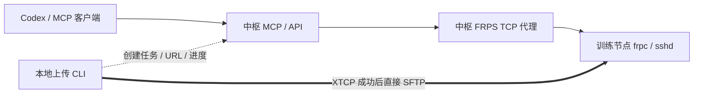
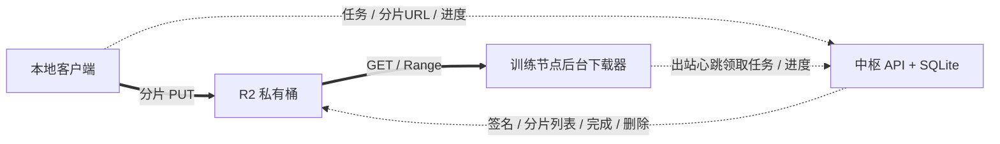

# Fleet Hub 稳定性、后台任务与备用传输方案

核查日期：2026-10-16。本文区分已写入工作区的改动、隔离验证和后续设计。未部署、未推送、未创建 PR，未读取生产凭据或上传真实数据。代码行号以本次工作区为准。

## 最值得关注的结论

1. **P2P 等待 60/180 秒后零字节失败属于连接问题，不能据此认定带宽不足。** 当前上传已经通过 XTCP 两端直连。修正了 SSH 握手过早重试，但无法保证穿透任意 NAT；需要独立的 HTTPS 对象存储备用路径。
2. **节点自动更新已增加本地候选确认和失败回滚。** 客户仍使用一条注册命令；原节点身份和启动命令保留。升级先保存旧版本，失败自动恢复；活跃上传期间延后安装。首次旧版本迁移成功以后才拥有完整保护。
3. **MCP 通知不等于唤醒 Codex。** 应将定时、监控和长任务独立运行，工具快速返回任务 ID；模型按需读取结果。主动开始新的模型任务需要宿主或 SDK 调度能力，不能仅靠 MCP 服务端承诺。
4. **推荐 R2 预签名分片上传/下载，而非让 Worker 代理一个 10GB WebDAV PUT。** R2 有真正文件 GET、Range 和分片恢复接口；免费额度是计费账户中的 10 GB-month/月，不能视为匿名、永不收费或自动硬限额。

## 当前数据与控制路径

MCP 的 `ssh_upload/ssh_download` 中 `local_path` 位于中枢，文件会经过中枢；电脑上传命令使用另一条 XTCP 路径。两者不能混为同一种吞吐指标。创建 XTCP 任务时，中枢仍需通过控制隧道给目标安装临时 SSH 公钥：[`create_transfer`](../app/app.py#L375)。这一步失败时尚未进入数据传输。

## 已实施的最小改进

| 改动与证据 | 解决的问题 | 保留的边界 |
| --- | --- | --- |
| [`transfer.py:260`](../app/static/transfer.py#L260)：回环连接 5 秒，SSH 握手最多 30 秒，socket 关闭定时器控制整体截止时间 | 原 SSH 5 秒窗口可能早于 FRP 的 20 秒隧道等待结束，导致过早重试；认证/主机密钥错误现在直接失败 | 不是 NAT 算法改进；UDP 被禁或 NAT 不兼容仍会失败。未盲目开启 `keepTunnelOpen` 或中枢中继 |
| [`transfer.py:95`](../app/static/transfer.py#L95)：以 1MiB 块校验 FRP 程序；日志只读取末尾 16KiB | 避免读完整二进制或无界日志；不增加数据集全量哈希 | 仍保留原有完整性校验次数；SFTP 文件传输目前仍无跨进程续传 |
| [`node.py:417`](../app/static/node.py#L417)：FRP 下载临时落盘、边下载边校验、流式提取、原子替换 | 降低安装峰值内存；失败时保留旧程序 | 安装期间需要压缩包和解压程序的临时磁盘空间 |
| [`node.py:853`](../app/static/node.py#L853)：短暂 Python bootstrap 设置父进程退出保护，再 exec FRP | 消除多线程进程中 `preexec_fn` 的死锁风险 | Linux 专用，不改变常驻 FRP 协议 |
| [`node.py:667`](../app/static/node.py#L667)、[`node-supervisor.py:85`](../app/static/node-supervisor.py#L85)：固定入口、可替换实现、保存旧版、试运行和回滚意图持久化 | 候选导入/语法失败、早退、初始化挂死不会反复安装同一坏版本；回滚中断后可继续 | 最近 8 个失败 SHA 抑制；保护器、Python、FRP 二进制和既有 FRP 配置暂不自动升级 |
| [`node.py:870`](../app/static/node.py#L870)：试运行期间临时 readiness 线程独立检查本地初始化与 FRP 存活 | DNS/慢 HTTP 不再把健康候选误判为坏版本；FRP 死亡/换代撤销健康信号 | 确认只证明本地初始化和进程存活，不证明 HTTP 主循环响应、FRP 公网隧道或 MCP 可达；确认后线程退出 |
| [`app.py:324`](../app/app.py#L324)、[`app.py:385`](../app/app.py#L385)、[`node.py:779`](../app/static/node.py#L779)：心跳更新门控覆盖授权准备和有效传输任务 | 发现新版本时先下载，传输繁忙/心跳失败则延后安装，无需重复下载 | 任务快照不是原子更新租约；新任务与安装仍有小竞态，不能保证绝不打断上传 |
| [`install.sh:13`](../app/static/install.sh#L13)、[`install.sh:62`](../app/static/install.sh#L62)：复用已有 Python，下载停滞检测，版本交错最多再校验一次 | 少装运行时，避免死镜像等待；正常发布竞争无需客户立即重跑命令 | 非版本竞争的网络、JSON、语法错误仍明确失败；不执行未校验源码 |
| [`app.py:55`](../app/app.py#L55)、[`app.py:208`](../app/app.py#L208)、[`send.sh`](../app/static/send.sh)、[`send.ps1:61`](../app/static/send.ps1#L61)：内容 ETag 和 304 | 不变上传脚本不重复下载，中枢不为每次查询重新哈希文件；失败不破坏缓存 | Windows 实现本次仅审阅，未运行 PowerShell |
| [`fleet_update.py:89`](../ops/fleet_update.py#L89)：Git wheels 树和 Python 环境相同时复制已有独立依赖目录 | 应用更新无需重复解包/安装相同 wheel；移除发布目录冗余 wheel 副本 | 保留编译、依赖导入、健康检查、回滚；不共享可变硬链接。已装运维脚本需单独更新才生效 |
| [`app.py:69`](../app/app.py#L69)、[`mcp_entry.py:151`](../app/mcp_entry.py#L151)、[`index.html`](../app/static/index.html)：HTTP 进程 RSS、巡检新鲜度、更新状态、简要监控工具 | 区分服务失联、样本陈旧、进度失联和确认失败；减少模型重复 SSH 查询与不必要返回数据 | RSS 不代表 MCP/FRP/Caddy/整机总内存；没有资源样本时保持未知 |

此前已完成的同一工作区改动包括：更新检查和基础资源采集移出心跳主循环、FRP 状态快照过期、巡检异常恢复、延迟摘要 15 秒缓存、状态查询消除逐节点 metadata 查询、MCP 回环 HTTP 池、前端可见页按需查询。它们保留在本次工作区中。

## 定时、监控与 MCP 的最小方案

已有 `ssh_spawn` 返回会话 ID，配合 `session_recv(timeout=0)` 可立即读取已有输出，避免阻塞式等训练结束。但会话只在 MCP 进程内存中，默认闲置清理；MCP 重启会关闭这些会话。可靠长期训练应由目标机现有的服务管理/任务进程负责，Fleet 保存任务状态和结果。

建议新增少量普通工具 `fleet_job_start/get/list/cancel`、`fleet_schedule_put/list/delete`、`fleet_events(after_id, limit)`，复用 SQLite 和心跳；短请求返回任务 ID，不增加一个长时间阻塞的 wait 工具。定时器记录 UTC next_run、错过策略、去重键和租约；监控规则用阈值持续时间、恢复阈值、冷却时间消抖。任务执行与模型是否在线分离；中枢重启后恢复未完成状态，不能把超时当作远端操作已取消。

需要主动让 Codex 开始新的处理时，由明确配置的外部宿主/SDK 消费事件并创建任务；这不是目前 MCP 配置自动具备的能力。当前规范、SDK 与 Codex 的事实核查和详细接口设计见 [MCP 报告](mcp-background-tasks.md)。上述持久任务/调度接口是设计，尚未实现。

## Cloudflare 备用路径

Worker 可选，既不必须部署，也不应把文件先经过中枢再转发。免费 Workers 单请求体上限 100MB、isolate 内存 128MB；10GB 普通 WebDAV PUT 不适用。HTTP chunked 传输编码不等于应用层分片。

R2 Standard 官方免费额度为每月 10 GB-month、100 万 Class A、1000 万 Class B 请求，出口免费；需账户和 R2 订阅 checkout。10GiB 大于 10GB，未完成分片、旧对象和新对象重叠也占容量。必须应用侧预留容量、限制并发、完成后删除、失败清理和生命周期兜底；不能承诺绝不产生费用。

最小适配器包含 `create_upload / presign_parts / list_parts / complete_upload / presign_download / head / abort / delete`。按需给小批分片签 URL，过期重签；本地 sidecar 原子记录 task/upload_id/parts/源文件 size+mtime，重启用 ListParts 对账，只补缺片。下载绑定不可变 key 和 ETag，以 `Range + If-Match` 恢复；仅正确 206 才追加，200 重开、412 停止核实。multipart ETag 不能当作全文件 MD5。

当前 `create_transfer` 必须先通过 FRP/SSH，故 R2 分支要独立建任务，并由节点通过认证心跳领取后台下载任务；不是在 CLI 最外层捕获异常后加一个 HTTP 上传就完成。P2P 超时可以按策略回退，身份失败、主机密钥不符、节点撤销、目标磁盘满或权限错误必须保留原失败语义。

详细官方来源、限额、接口、状态机、涉及文件和恢复测试计划见 [Cloudflare 报告](cloudflare-fallback.md)。R2/Workers 适配器当前没有实现或部署；storage.to 不能仅凭分享 `file.url` 当作直接下载接口，原无头下载缺口不能由“提供上传 API”自动消除。

## 验证记录与收益边界

实际执行的检查使用临时目录、合成配置、本机回环服务、假 FRP 或真实本机子进程；未使用真实节点或生产存储。

- Hub API、心跳门控、发布清单、进度和上传启动器：63 个测试通过。并发 ASGI 测试确认 SSH 授权尚未入库时也暂停更新，成功后交给任务记录保护，失败后释放。
- MCP、probe、上传启动器补测：46 个测试、31 个子测试通过。与上一组有重叠，不相加为独立总数。
- 页面：12 个测试通过，覆盖可见页查询、摘要重试节流、独立样本新鲜度、RSS 和升级状态。
- P2P：22 个针对性测试通过；真实本机 Paramiko 对端卡在 banner/auth 时整体截止时间能生效。虚拟时钟的 60/90/180 秒场景只证明预算逻辑，不证明真实 NAT 可穿透。
- 节点安装启动器：10 个测试、4 个子测试通过，包含实际回环 HTTP 版本交错与失败清理。
- 节点更新、生命周期与指标：45 个测试、18 个子测试通过。真实进程验证坏版回滚、回滚中断恢复、旧启动命令迁移、长时间阻塞心跳、FRP 连续退出、初始化挂死、确认后 readiness 线程退出。
- 更新器：11 个隔离发布场景通过，使用本地 bare Git、离线 pip 和模拟 HTTP 服务，覆盖依赖复用、无共享 inode、变化失效、损坏依赖、健康失败和中断回滚。
- Shell 语法及 `git diff --check` 通过；没有执行全量测试。

隔离资源实验：24MiB 不可压缩 FRP 模拟包的安装峰值 RSS 从约 63.70MiB 降至 20.14MiB，Python 分配峰值 64.38→4.09MiB；32MiB 程序的单次校验分配峰值约 32.00→2.01MiB。依赖准备的单次本机测量为 1.353→0.998 秒。它们是合成验证，不是生产安装耗时、整机内存或网络吞吐承诺。

未实际验证：真实 NAT/UDP/STUN 成功率、生产 SSH 冷热连接耗时、跨地区吞吐、R2 签名/续传/计费、云端 Codex 主动唤醒、Windows PowerShell 与真实 ARM64。心跳 HTTP 仍是同步请求，urllib 的 socket timeout 不是包含 DNS/整个响应的严格墙钟预算；本次避免了它误拒绝候选，未将其等同为已解决全部心跳阻塞。

## 后续按收益排序

1. 先对本次候选/回滚机制做少量测试节点灰度，记录首次迁移、更新中断和回滚结果；此操作尚未执行。
2. 实现持久任务记录及事件读取，让监控/定时任务独立于模型等待；在明确宿主能力后再增加主动触发模型。
3. 增加 R2 显式通道与可恢复分片，以 40–80MiB 合成文件验证过期重签、进程中断、丢响应对账、Range 和清理，再启用符合分类的自动回退。
4. 采集生产 `prepare_ms / tunnel_ms / ssh_ms / first_byte_ms / transfer_bps`，以及两端 CPU/磁盘、中枢进程 RSS；凭指标再决定是否调整 P2P 连接预算、并发或协议。不要用零字节失败推断带宽，也不要靠无界重试掩盖连接故障。
